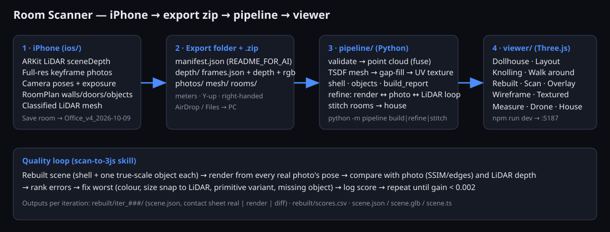

# Room Scanner → Room Explorer

Scan a real room with an iPhone (LiDAR + photos + poses + walls), export one folder/zip per room, turn it into a photo-textured,
true-scale, walkable 3D model in a web viewer — and let Claude rebuild it as clean separate objects (scan-to-3JS).

Units: **meters** everywhere. Right-handed, **Y-up** (ARKit). Spec: [docs/SCHEMA.md](docs/SCHEMA.md). iPhone build: [BUILD_IOS.md](BUILD_IOS.md).

**Status (be aware):** the PC side (schema, pipeline, refinement loop, stitching, importer, viewer) is built and tested on synthetic data only.
The iOS app is written but **not yet compiled or run** (needs a Mac + Xcode). No real iPhone export has been tested.

## Quick start (Windows PC, synthetic room — no iPhone needed)
1. Install Python 3.11+ and Node 20+.
2. Open a terminal in `room-scanner`.
3. `python -m venv .venv`
4. `.venv\Scripts\activate`
5. `pip install -r requirements.txt`
6. `cd viewer`
7. `npm install`
8. `cd ..`
9. `python tools/make_synthetic_export.py` — makes `data\Test-Room_v1_<date>\` (150 frames, ~45 s).
10. `python tools/validate_export.py data\Test-Room_v1_<date>` — must print `VALID`.
11. `python -m pipeline build data\Test-Room_v1_<date>` — point cloud, textured GLB, shell, objects, `build\build_report.json` (a few minutes).
12. `python -m pipeline refine data\Test-Room_v1_<date> --iters 8` — scan-to-3JS loop; see `rebuilt\scores.csv` and `rebuilt\iter_###\contact.png`.
13. `cd viewer` then `npm run dev`
14. Open http://127.0.0.1:5187 in Chrome.

## With a real scan
1. Scan in the iPhone app (see BUILD_IOS.md), tap **Save room**.
2. In the app library tap the share icon → AirDrop / Save to Files.
3. Unzip into `room-scanner\data\` (you get `data\Office_v4_2026-10-09\manifest.json`).
4. Run steps 10–12 above with that folder name, then refresh the viewer. (Or drop the **built** folder as a .zip onto the viewer window.)

## Without the iPhone app (stopgap)
1. Export a `.glb`/`.obj`/`.ply` from Polycam / Scaniverse / 3D Scanner App (USDZ → convert to GLB first).
2. `python -m pipeline import C:\path\scan.glb --out data --name "Basement"` (add `--up z` if the model lies on its side).
3. Open the viewer; use **Textured**, **Scan**, **Rebuilt (box shell)**.

## Whole house
1. Build each room (steps 11).
2. `python -m pipeline stitch data\RoomA_v1_<date> data\RoomB_v1_<date> --out data\house` (add `--icp` to polish with ICP).
3. Viewer → **Whole house** tab. Hand-tune `data\house\alignment.json` (`x`, `z` meters, `yaw` radians) and refresh.

## Viewer cheat-sheet
Sidebar: scans/versions · **View** Dollhouse (walls facing you fade) / Layout (top-down) / Knolling (objects laid flat) / Walk around (WASD + drag, eye height 1.6 m, wall + furniture collision) ·
**Source** Rebuilt / Scan / Overlay / Wireframe / Textured · **Camera** Drone tour, Home/Top/Front/Side, Zoom ±, position readout, Copy view link ·
**Measure** (click two points → mm/m) · Render quality Auto/Full detail · drop an export `.zip` (must contain `build/`) on the window.
Phone: the layout stacks; Walk uses drag-to-look (no on-screen joystick yet).

## Folders
`ios/` Swift app · `pipeline/` Python (`build`, `refine`, `stitch`, `import`) · `viewer/` Vite+TS+Three.js · `tools/` generator, validator, screenshots ·
`schemas/` JSON Schemas · `docs/` spec, diagram, screenshots · `.claude/skills/scan-to-3js/` the refinement skill · `config.yaml` all tunables (`python tools/gen_swift_config.py` pushes capture values to the app).
